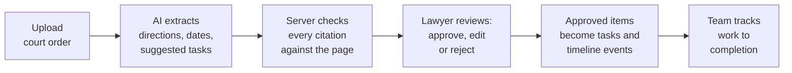
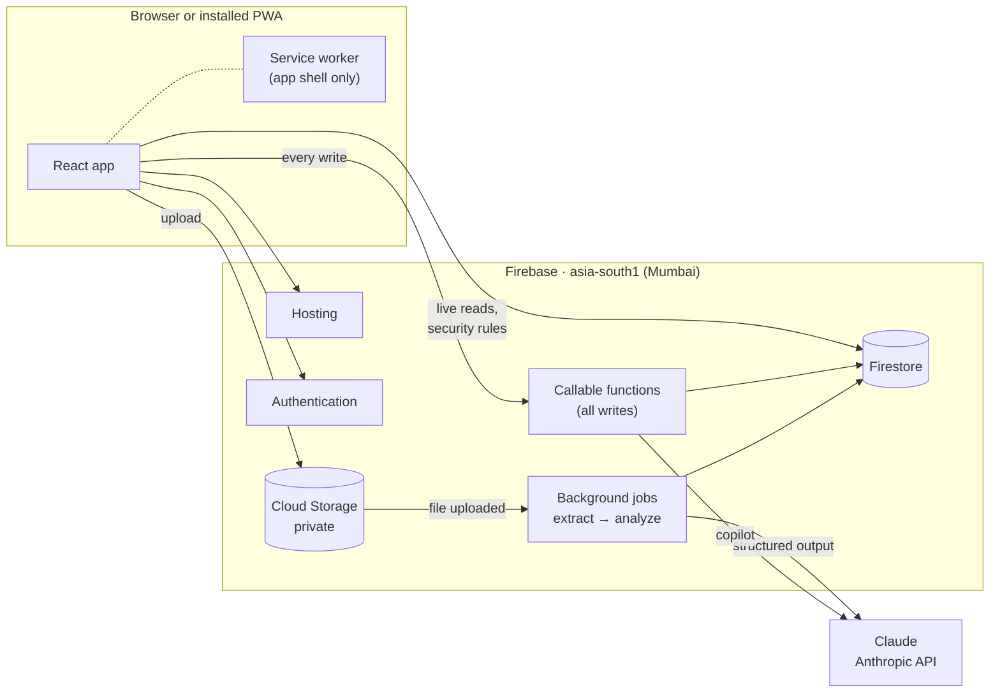

# CasePilot AI

**Less paperwork. Smarter case management. Never miss a critical task.**

AI-powered legal case management for Indian advocates, law firms and corporate legal teams.
Upload a court order and CasePilot turns it into a reviewable action plan: every direction, date and
suggested task links back to the page it came from, and nothing enters the case until a lawyer
approves it.

Hackathon team repository for Neural Ninjas - [hackindia-team:ai-for-lawyers-hackathon:neural-ninjas]

> **Live app:** https://casepilot-neural-ninjas.web.app
>
> **Status:** in development. Days 1–5 of 8 are done and deployed: the full MVP workflow from
> court-order upload through Claude analysis with checked citations, lawyer review, tasks, timeline
> and dashboard. See [Features](#features) for what works today and the
> [implementation plan](docs/IMPLEMENTATION_PLAN.md) for what comes next.

---

## The idea

### The problem

Legal professionals manage case information across PDFs, Word files, emails, spreadsheets and
calendars. A single court order can carry several directions, each with its own deadline and
responsible party, buried in dense text. Missing one direction or misreading one date can have
serious consequences for a client.

### The solution

CasePilot reads a court order and proposes what needs to happen next:



### What makes it different

- **Source-linked.** Every extracted direction, date and fact cites a page and a short quote. The
  server checks that the quote really appears on that page; findings that fail the check are flagged
  for review.
- **The lawyer stays in control.** AI output is only ever a proposal. Tasks and hearing dates enter
  the case only after an authorized person approves them.
- **Honest about uncertainty.** "Within 14 days" is never silently turned into a confirmed deadline.
  Conditional directions stay conditional, and unclear text is flagged instead of guessed.
- **Built for Indian practice.** Dates in India Standard Time, English and Hindi summaries, and data
  stored in Firebase's Mumbai region.

### Who it's for

| Workspace | Use |
|---|---|
| **Solo advocate** | Personal matters, documents, hearings and follow-ups |
| **Law firm** | Lawyers and paralegals share case files and assign work |
| **Corporate legal team** | Disputes, employment and regulatory matters with internal owners and external counsel |

### Deliberately out of scope

Predicting court outcomes, giving legal advice, filing documents or sending notices automatically,
and confirming inferred deadlines without a lawyer.

---

## Features

| Feature | What it does | Status |
|---|---|---|
| Accounts and workspaces | Email or Google sign-in; one workspace per practice, firm or legal team | ✅ Built |
| Roles | Owner, admin, lawyer, paralegal and viewer, enforced on the server | ✅ Built |
| Installable app (PWA) | Installs on Android, desktop and iOS; app shell loads offline; update prompt | ✅ Built |
| Trusted devices | Case data is cached for offline reading only on devices the user trusts; signing out wipes it | ✅ Built |
| Audit trail | Every change is recorded with who made it, in the same transaction; per-case activity feed | ✅ Built |
| Case management | Create, edit, archive and search cases; filter by status, court and lawyer; assign lawyers | ✅ Built |
| Team | Invite by private link, verified-email acceptance, role changes, suspension | ✅ Built |
| Private document upload | PDF and DOCX up to 15 MB, file-signature checked, private storage | ✅ Built |
| AI summary and extraction | Directions, dates, facts and proposed tasks, with page citations checked against the text | ✅ Built |
| Human review | Side-by-side PDF and findings; approve, edit or reject each item; bulk-approve items without warnings | ✅ Built |
| Tasks and timeline | List and board views, a cross-case task list, verified hearing dates, dates to confirm, overdue flags, calendar | ✅ Built |
| Dashboard | Upcoming hearings, urgent tasks, reviews waiting, recent activity | ✅ Built |
| Case copilot | Questions about the case files, answered with document and page references | Day 6 |
| Hindi summaries | Machine-translated summaries, clearly labelled | Day 6 |

---

## Architecture



- **Reads come straight from Firestore** with real-time listeners, guarded by security rules.
- **Every write goes through a Cloud Function** that checks membership and role, validates input,
  and writes an audit entry in the same transaction. The app cannot write case data directly.
- **Documents are processed in the background.** An upload triggers validation, text extraction and
  AI analysis as retry-safe queued jobs. The result waits as `pending_review` until a lawyer acts on
  it.
- **The AI never acts on its own.** It returns schema-validated proposals; only a lawyer's review
  creates tasks or events.
- **Confidential data stays out of caches and logs.** The service worker caches only the app shell,
  logs carry IDs instead of document text, and documents are read through authenticated SDK calls,
  never public links.

Full design: [docs/ARCHITECTURE.md](docs/ARCHITECTURE.md). Build schedule:
[docs/IMPLEMENTATION_PLAN.md](docs/IMPLEMENTATION_PLAN.md). Product blueprint:
[CasePilot_AI_Hackathon_Blueprint.md](CasePilot_AI_Hackathon_Blueprint.md).

### Tech stack

| Layer | Technology |
|---|---|
| Frontend | React 19, TypeScript, Vite, React Router, Tailwind CSS, shadcn/ui, TanStack Query, React Hook Form, Zod |
| PWA | vite-plugin-pwa with a custom Workbox service worker |
| Backend | Cloud Functions for Firebase (2nd gen, Node 24) |
| Data | Cloud Firestore, Cloud Storage for Firebase |
| Auth and abuse control | Firebase Authentication, App Check |
| AI | Claude (`claude-opus-5-5`) through the Anthropic API, with structured outputs |
| Shared contracts | Zod schemas and the permission matrix, used by both frontend and backend |

### Repository layout

```text
.
├─ apps/web/            React PWA
├─ functions/           Cloud Functions (bundled with esbuild)
├─ packages/shared/     Zod schemas, enums, permissions, paths, date helpers
├─ seed/               Fictional sample court orders and their generator
├─ tests/rules/         Firestore security-rules tests
├─ tests/integration/   Cloud Functions tests against the emulators
├─ docs/                Architecture and implementation plan
├─ firebase.json        Hosting, Functions, emulators
├─ firestore.rules      Firestore security rules
├─ storage.rules        Storage security rules
└─ firestore.indexes.json
```

---

## Getting started

### Prerequisites

- Node.js 24 (24.12 or later recommended)
- Java 21, for the Firebase emulators

### Run locally (no Firebase account needed)

```bash
npm install
npm run emulators       # terminal 1: Auth, Firestore, Storage, Functions; Emulator UI on http://localhost:4000
npm run dev:emulator    # terminal 2: the app on http://localhost:5173
```

The emulators run a local demo project (`demo-casepilot`) with no cloud resources.

Locally, AI analysis runs in **replay mode**: uploading `seed/samples/sample-order.pdf` replays a
hand-written test analysis (labelled in the app as test data), and any other file stops with "no
recorded analysis". To use live Claude locally, put `AI_MODE=live` in `functions/.env.local` and
`ANTHROPIC_API_KEY=<your key>` in `functions/.secret.local`. Both files are gitignored.

### Deploy

The app deploys to the Firebase project `casepilot-neural-ninjas` (set in `.firebaserc`). Its
public web config is in `apps/web/.env.production`.

| Part | Command | State |
|---|---|---|
| Web app (Hosting) | `npm run deploy:web` | Live at https://casepilot-neural-ninjas.web.app |
| Firestore rules and indexes | `npm run deploy:rules` | Deployed; database in `asia-south1` |
| Sign-in providers | `npx firebase deploy --only auth` | Email/Password and Google enabled |
| Cloud Functions | `npx firebase deploy --only functions` | `createOrganization` deployed in `asia-south1` |
| Storage rules | `npx firebase deploy --only storage` | Deployed; bucket in `asia-south1`, CORS set from `storage.cors.json` |

The project is on the Blaze plan. Two one-time steps remain for whoever owns the project:

1. **Allow Storage rules to read Firestore.** Run `npx firebase deploy --only storage` in an
   interactive terminal and answer **Yes** when asked to grant the cross-service IAM role. Until
   then, uploads are denied (needed from Day 3).
2. **Set a budget alert** in Google Cloud Billing so AI and function costs can't surprise you.

### Demo fallback

If the Claude API is unavailable during a demo, the deployed app can replay a recorded live run
of `seed/samples/sample-order.pdf` (`functions/fixtures/recordings.live.json`). The app labels
replayed analyses as such. To switch it on, create `functions/.env.casepilot-neural-ninjas` with:

```
AI_MODE=fixture
AI_FIXTURES_FILE=fixtures/recordings.live.json
```

then run `npx firebase deploy --only functions`. Delete the file and deploy again to go back to
live Claude. To record a new run, start the emulators against the real project with
`AI_RECORD_FILE=fixtures/recordings.live.json` in `functions/.env.local`, and upload the file.

To use your own project instead, create one with Firestore in `asia-south1`, put its ID in
`.firebaserc`, and replace the values in `apps/web/.env.production` with its web config.

### Scripts

| Command | What it does |
|---|---|
| `npm run dev:emulator` | Web app against the local emulators |
| `npm run dev` | Web app against the project in `.env.local` |
| `npm run emulators` | Build the functions and start the emulators |
| `npm run build` | Build the functions and the web app |
| `npm run typecheck` | Typecheck every workspace |
| `npm run lint` | ESLint across the repo |
| `npm test` | Unit tests |
| `npm run test:rules` | Security-rules tests against the Firestore emulator |
| `npm run test:integration` | Cloud Functions tests against the Auth, Firestore, Functions, Storage and Tasks emulators |
| `npm run eval -w @casepilot/functions` | Live prompt evaluation on synthetic orders (needs `ANTHROPIC_API_KEY`; calls Claude) |
| `npm run deploy` | Deploy everything to Firebase |
| `npm run deploy:web` | Build and deploy only the web app |
| `npm run deploy:rules` | Deploy only the Firestore rules and indexes |

### Troubleshooting

- **"Cannot determine backend specification. Timeout after 10000"** on the first emulator start:
  the first load of the functions was slow. Run `npm run build -w @casepilot/functions` and the
  emulator reloads them, or set `FUNCTIONS_DISCOVERY_TIMEOUT=30` before starting.
- **"Could not start Firestore Emulator, port taken"**: an emulator from an earlier run is still
  alive. On Windows, end the leftover `java.exe` running `cloud-firestore-emulator` in Task Manager.
  Firestore runs on port 8180, not the default 8080, because 8080 is often blocked on Windows.
- **"Cannot find module '@rolldown/binding-…'" or a missing `@esbuild/…` package** after
  `npm install <package>`: an npm bug pruned the native binaries. Delete `node_modules` and
  `package-lock.json`, then run `npm install` once.
- **The first callable request times out locally**: on some Windows machines the function worker
  takes 30 seconds or more to start the first time. Retry once it has warmed up.

---

## Responsible AI and data protection

- Demo data is synthetic and clearly labelled; no real client documents are used.
- Uploaded documents are treated as untrusted input; embedded instructions are ignored.
- AI requests are made only from the server; the Anthropic API key lives in Secret Manager and never
  reaches the browser. Anthropic's data-retention terms apply to what is sent.
- Before use with real client data, the AI provider's data terms, professional confidentiality
  duties and the Digital Personal Data Protection Act, 2023 need review.

---

## Team

**Neural Ninjas**, HackIndia AI for Lawyers hackathon.

## License

[MIT](LICENSE)
