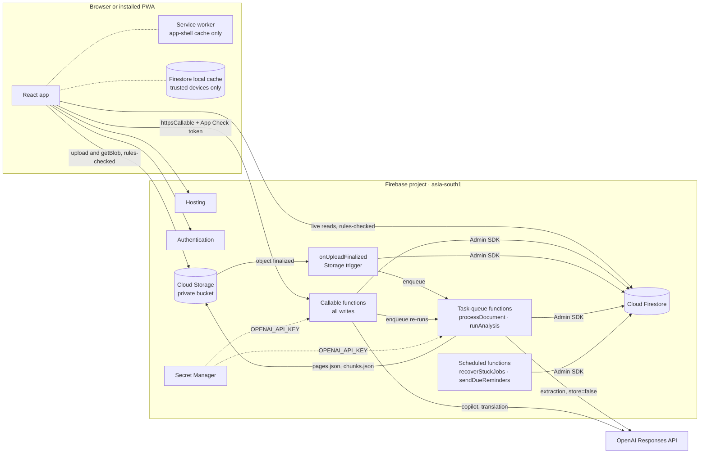
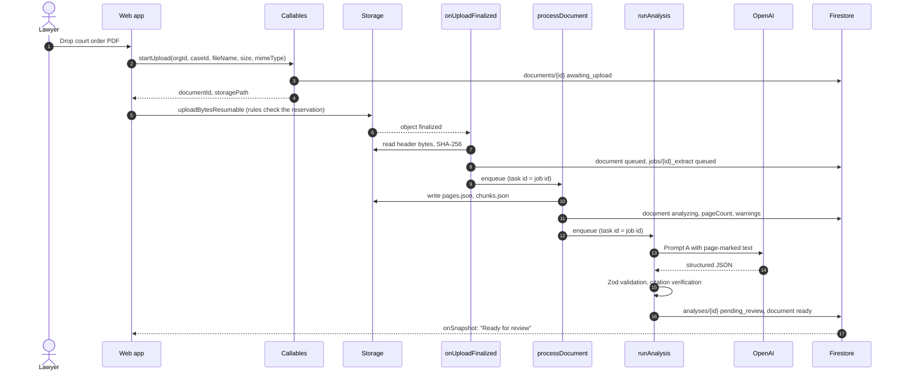
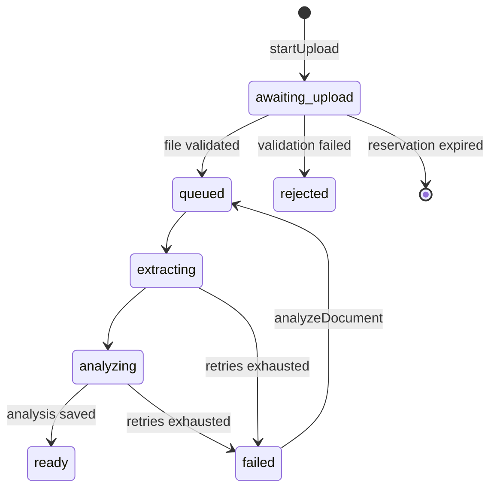

# CasePilot AI — System Architecture

> Companion to [CasePilot_AI_Hackathon_Blueprint.md](../CasePilot_AI_Hackathon_Blueprint.md).
> The blueprint defines **what** to build. This document fixes **how**: a Firebase backend and a
> React frontend that installs as a PWA. Where this document changes the blueprint, §13 lists the
> change and the reason. The build order lives in [IMPLEMENTATION_PLAN.md](IMPLEMENTATION_PLAN.md).

**Status:** Draft v1 · 3 Nov 2026 · **Scope:** blueprint P0 + P1, with seams left for P2.

---

## 1. Key decisions

| Area | Decision |
|---|---|
| Frontend | React 19 + TypeScript on Vite · React Router · shadcn/ui + Tailwind · TanStack Query · React Hook Form + Zod |
| PWA | `vite-plugin-pwa` with our own Workbox service worker (`injectManifest`). Installable; app shell works offline; Firestore offline cache is opt-in per device; no confidential data in service-worker caches |
| Hosting | Firebase Hosting (SPA rewrites, preview channels). Auth handler served from the same domain |
| Auth | Firebase Authentication — Email/Password and Google |
| Writes | **Every write goes through a callable Cloud Function.** The client never writes Firestore directly |
| Reads | Client reads Firestore directly with real-time listeners, guarded by Security Rules |
| Backend | Cloud Functions for Firebase, 2nd gen, Node 22, TypeScript |
| Async work | Storage trigger → Firebase task-queue functions (Cloud Tasks) for text extraction and AI analysis |
| Scheduling | `onSchedule` functions (Cloud Scheduler), time zone `Asia/Kolkata` |
| Database | Cloud Firestore, Native mode, `asia-south1` (Mumbai) |
| Files | Cloud Storage for Firebase, `asia-south1`, private. Read through the SDK (`getBlob`), never through permanent download URLs |
| AI | OpenAI Responses API with Structured Outputs and `store: false`, behind an `AiProvider` interface. A fixture provider serves tests and the demo fallback |
| Secrets | `OPENAI_API_KEY` in Secret Manager via `defineSecret` |
| Abuse control | App Check (reCAPTCHA Enterprise) enforced on callables and Storage; per-organization daily AI quota |
| Shared contracts | `packages/shared`: Zod schemas, enums, the permission matrix and path builders, imported by both web and functions |

> **Region is permanent.** Firestore and the default Storage bucket cannot move after creation.
> Create both in `asia-south1` on Day 0. Functions run in the same region.

---

## 2. System context



Three paths carry all traffic:

1. **Read path.** React subscribes to Firestore. Security Rules decide what each user may see.
2. **Write path.** React calls a callable function. The function validates input, checks membership
   and role, then writes the change and its audit entry in one transaction.
3. **Document path.** React uploads to Storage. A trigger validates the file and queues extraction,
   then AI analysis. The result lands in Firestore as `pending_review`, and the UI updates through
   its listener.

---

## 3. Repository layout

```text
casepilot/
├─ apps/web/                 React PWA (Vite)
├─ functions/                Cloud Functions, bundled with tsup
├─ packages/shared/          Zod schemas, enums, permissions, Firestore/Storage path builders
├─ evals/                    AI fixtures, expected outcomes, eval runner
├─ seed/                     demo org/case seeding, reset script, synthetic court orders
├─ tests/rules/              Firestore + Storage rules tests (emulator)
├─ firebase.json  .firebaserc
├─ firestore.rules  firestore.indexes.json
├─ storage.rules  storage.cors.json
└─ package.json              npm workspaces
```

Use **npm workspaces**. `functions/` is bundled with tsup so `@casepilot/shared` is compiled into
the output. `functions/package.json` lists only published npm packages. `firebase deploy` installs
dependencies in Cloud Build and cannot resolve workspace links.

---

## 4. Frontend

### 4.1 Source layout

```text
apps/web/src/
├─ app/            router.tsx, providers.tsx, layouts/ (AppShell, CaseLayout), guards/
├─ features/       auth · onboarding · dashboard · cases · documents · review · timeline
│                  · tasks · copilot · team · settings   (each owns its pages, components, hooks)
├─ components/ui/  shadcn/ui primitives
├─ lib/            firebase.ts · callables.ts · live-query.ts · dates.ts · i18n.ts · can.ts
└─ pwa/            sw.ts · UpdatePrompt.tsx · InstallPrompt.tsx · useOnline.ts
```

### 4.2 Routes and guards

The blueprint §3 routes, plus `/invite/:orgId/:inviteId`:

```text
/login                                   public
/invite/:orgId/:inviteId                 public → sign in → acceptInvitation
/onboarding                              RequireAuth
AppShell  = RequireAuth + RequireOrg     sidebar, top bar, org switcher, offline banner
  /dashboard  /cases  /cases/new  /tasks  /calendar  /team  /settings
  CaseLayout                             case header + tabs
    /cases/:caseId/overview | documents | ai-review/:analysisId | timeline | tasks | copilot
```

- `RequireAuth` waits for `onAuthStateChanged`, then redirects to `/login?next=…`.
- `RequireOrg` reads `users/{uid}`. With no memberships it sends the user to `/onboarding`.
  Otherwise the active org is `lastActiveOrgId`, falling back to the first membership. The active
  org lives in React context, not the URL, which keeps the blueprint's routes.
- Every route is `lazy()`-loaded. `react-pdf` and the copilot load only on the routes that use them.
- On phones the sidebar becomes a bottom bar holding Dashboard, Cases, Tasks and More. The AI review
  split pane becomes tabs.

### 4.3 Data access

| Kind | Mechanism |
|---|---|
| Live reads: case, documents, analyses, tasks, events, members | `useLiveDoc(path)` and `useLiveQuery(query)` in `lib/live.ts` subscribe with `onSnapshot` and unsubscribe on unmount. Listeners stay out of the TanStack Query cache, so a listener never outlives the screen that opened it |
| Writes | `useMutation` around typed `httpsCallable` wrappers in `lib/callables.ts`. Input types come from `packages/shared`, so a contract change fails the build on both sides |
| Files | `getBlob(ref)` for the PDF viewer, auth-checked on every request. Revoke the object URL on unmount |
| Permissions in the UI | `can(role, action, orgPolicy)` from `packages/shared` hides or disables controls. This is convenience only; functions enforce the same matrix |

- Every collection-group query includes `where('orgId', '==', activeOrgId)`. Rules are not filters,
  so a query the rules cannot prove safe fails.
- Set `{ timeout: 120_000 }` on the `askCaseCopilot` and `reviewAnalysis` callables.

### 4.4 Key components

- **ProcessingStatus** shows a live chip per document: awaiting upload → queued → extracting →
  analyzing → ready, or failed / rejected. A failed document offers Retry.
- **ReviewWorkspace** (`/ai-review/:analysisId`) has the PDF on the left and extracted items on the
  right, grouped as Summary, Directions, Dates, Proposed tasks and Facts.
  - Each item shows a `SourceRef` chip. Clicking it jumps the viewer to the page and highlights the
    quote in the text layer.
  - Unverified citations, relative deadlines ("within 14 days") and conditional directions carry a
    visible warning.
  - Each item has Approve, Edit and Reject. Bulk approve skips items with warnings.
- **Timeline** lists events in date order. Verified events are solid; `needs_review` events are
  dashed and offer "Verify date".
- **TaskBoard** switches between list and kanban. A task is overdue when `dueDateOnly` is before
  today in IST.
- **CopilotChat** offers suggested questions. Answers render as plain text, with no HTML and no
  clickable model-generated links. Source chips open the PDF at the cited page. When the documents
  don't answer the question, the chat says so.

### 4.5 Dates, language and workspace types

- **Dates.** Store a `Timestamp`. For date-only legal dates, also store `YYYY-MM-DD`
  (`dueDateOnly`, `eventDateOnly`). Compute overdue and upcoming from that string, so a time-zone
  shift can never move a hearing by a day. Format with
  `Intl.DateTimeFormat('en-IN', { timeZone: 'Asia/Kolkata' })`.
- **Language.** UI strings use `react-i18next` (en, hi). Hindi document summaries come from the
  backend (§6.5).
- **Workspace types.** `packages/shared/workspaceConfig.ts` maps each type to feature flags.
  `solo` hides assignment and invites. `corporate` adds matter types (litigation, contract dispute,
  employment, regulatory) and external-counsel contacts.

### 4.6 PWA

**Goals:**
- installable on Android, desktop Chrome/Edge and iOS
- instant repeat loads
- recent case data readable offline on a trusted device
- nothing confidential in service-worker caches

**Service worker.** Use `strategies: 'injectManifest'` so we own the worker, and so FCM push (P2)
can live in the same worker later.

```ts
// apps/web/src/pwa/sw.ts
/// <reference lib="webworker" />
import { precacheAndRoute, cleanupOutdatedCaches, createHandlerBoundToURL } from 'workbox-precaching';
import { registerRoute, NavigationRoute } from 'workbox-routing';
import { CacheFirst } from 'workbox-strategies';

declare const self: ServiceWorkerGlobalScope;

cleanupOutdatedCaches();
precacheAndRoute(self.__WB_MANIFEST);

// SPA fallback. /__/ is reserved by Firebase Hosting (including /__/auth/handler) and must reach the network.
registerRoute(new NavigationRoute(createHandlerBoundToURL('index.html'), { denylist: [/^\/__\//] }));

// pdf.js worker is large; cache on first use instead of precaching.
registerRoute(({ url }) => url.pathname.includes('pdf.worker'), new CacheFirst({ cacheName: 'pdf-worker' }));

self.addEventListener('message', (e) => {
  if (e.data?.type === 'SKIP_WAITING') self.skipWaiting();
});

// No routes for Firestore, Storage or Functions: case data and documents never enter SW caches.
```

```ts
// apps/web/vite.config.ts (excerpt)
VitePWA({
  strategies: 'injectManifest',
  srcDir: 'src/pwa',
  filename: 'sw.ts',
  registerType: 'prompt',
  injectManifest: {
    globPatterns: ['**/*.{js,css,html,svg,png,woff2}'],
    globIgnores: ['**/pdf.worker*'],
  },
  manifest: {
    name: 'CasePilot AI',
    short_name: 'CasePilot',
    start_url: '/dashboard',
    scope: '/',
    display: 'standalone',
    theme_color: '#0f172a',
    background_color: '#ffffff',
    // Generated from public/logo.svg by `npm run generate-pwa-assets -w @casepilot/web`.
    icons: [
      { src: '/pwa-192x192.png', sizes: '192x192', type: 'image/png' },
      { src: '/pwa-512x512.png', sizes: '512x512', type: 'image/png' },
      { src: '/maskable-icon-512x512.png', sizes: '512x512', type: 'image/png', purpose: 'maskable' },
    ],
    shortcuts: [
      { name: 'New case', url: '/cases/new' },
      { name: 'My tasks', url: '/tasks' },
    ],
  },
})
```

Also add `screenshots` (one wide, one narrow) to the manifest so Android and desktop show the richer
install sheet. Self-host fonts so they are precached, with no runtime call to a font CDN.

**Updates.** `registerType: 'prompt'`. `useRegisterSW` shows a toast: "New version available —
Reload". Never auto-reload, because a lawyer may be halfway through a review.

**Install.** Capture `beforeinstallprompt` and offer "Install app" in the user menu. iOS Safari
has no install event, so show the Share → Add to Home Screen steps instead.

**Offline data.**

| Device setting | Firestore cache | Offline behaviour |
|---|---|---|
| **Trusted device**, opt-in at sign-in or in Settings | `persistentLocalCache` + `persistentMultipleTabManager` | Dashboard, cases, tasks, timeline and analyses read from cache, with a "Showing saved data" badge driven by `snapshot.metadata.fromCache` |
| **Default** | `memoryLocalCache` | App shell loads; data views show an offline empty state |

- Initialize Firestore lazily after sign-in, so the per-device choice applies.
- Every mutation is a callable, so actions are disabled offline with a "You're offline" tooltip.
  Writes to legal records are never queued silently.
- PDFs and the copilot need the network. PDFs are never cached.
- Sign-out runs `terminate(db)` → `clearIndexedDbPersistence(db)` → `queryClient.clear()` → reload.

**Auth inside the installed app.** Google sign-in uses `signInWithPopup` and falls back to
`signInWithRedirect` in iOS standalone mode. Set `authDomain` to the Hosting domain (a custom domain
or `<project>.web.app`) so the redirect handler is same-origin. The service-worker denylist above
keeps `/__/auth/handler` out of the SPA fallback.

**Hosting headers** (`firebase.json`):

| Path | `Cache-Control` |
|---|---|
| `/sw.js`, `/index.html` | `no-cache` |
| `/assets/**` | `public, max-age=31536000, immutable` |

Also send `X-Content-Type-Options: nosniff` and `Referrer-Policy: strict-origin-when-cross-origin`
on every path. Add a Content-Security-Policy on Day 7, after the auth and App Check flows are tested
against it.

---

## 5. Backend

### 5.1 Function inventory

`setGlobalOptions({ region: 'asia-south1', maxInstances: 10 })`. Callables set
`enforceAppCheck: true`, relaxed in the emulator.

| Function | Kind | Permission (§5.3) | Notes |
|---|---|---|---|
| `createOrganization` | callable | signed in | Org, owner member and `users.memberships` in one batch |
| `inviteMember` | callable | `member.manage` | Creates an invitation and returns an invite link (no email in MVP) |
| `acceptInvitation` | callable | invitee | Verified email must match the invitation |
| `updateMember` | callable | `member.manage` | Change role or status. The last owner cannot be demoted |
| `createCase` · `updateCase` · `archiveCase` | callable | `case.write` | Allow-listed fields only. `updateCase` refreshes denormalized `caseTitle` |
| `startUpload` | callable | `doc.upload` | Reserves `documentId` and storage path (§5.4) |
| `onUploadFinalized` | Storage trigger | system | Validates the file and queues extraction |
| `processDocument` | task queue | system | Per-page text, chunks, warnings |
| `runAnalysis` | task queue | system | Prompt A → analysis `pending_review` |
| `analyzeDocument` | callable | `ai.rerun` | Retry a failed document or re-run with a new prompt version |
| `reviewAnalysis` | callable | `ai.review` | Item decisions → tasks/events (§5.6) |
| `createTask` · `updateTask` | callable | `task.write` | Paralegals may edit only tasks assigned to them |
| `createEvent` · `updateEvent` · `verifyEvent` | callable | `event.write` / `event.verify` | `verifyEvent` recomputes `case.nextHearingDate` |
| `askCaseCopilot` | callable | `copilot.ask` | §5.7 |
| `translateSummary` | callable | `copilot.ask` | Hindi summary, cached on the analysis |
| `listCaseActivity` | callable | `case.read` | Sanitized audit entries for one case, paginated |
| `recoverStuckJobs` | schedule, every 15 min | system | Expired leases and stale upload reservations |
| `sendDueReminders` | schedule, 08:00 IST daily | system | P2 |

### 5.2 Callable pattern

Every callable follows the same five steps.

```ts
export const updateTask = onCall(callableOpts, async (req) => {
  const input = parseInput(UpdateTaskInput, req.data);                    // 1. Zod → invalid-argument
  const ctx = await requireMember(req, input.orgId, 'task.write');        // 2. signed in, active member, role
  return db.runTransaction(async (tx) => {
    const kase = await requireCase(tx, ctx, input.caseId, { writable: true }); // 3. case in org, not archived
    const task = await requireTask(tx, kase, input.taskId);
    assertTaskEditable(ctx, task);                                         //    paralegal: assigned tasks only
    tx.update(task.ref, pickAllowed(input.changes, TASK_EDITABLE_FIELDS)); // 4. allow-listed fields only
    audit(tx, ctx, {                                                       // 5. audit entry, same transaction
      action: 'task.updated', entityType: 'task', entityId: task.id, caseId: kase.id,
      metadata: { fields: Object.keys(input.changes) },
    });
  });
});
```

Functions throw only `HttpsError` codes: `unauthenticated`, `permission-denied`, `not-found`,
`invalid-argument`, `failed-precondition` and `resource-exhausted`. The client maps each code to a
toast.

### 5.3 Authorization

One matrix in `packages/shared` drives the backend checks and the UI gating. It encodes blueprint §6.

```ts
export const PERMISSIONS = {
  'case.read':     ['owner', 'admin', 'lawyer', 'paralegal', 'viewer'],
  'case.write':    ['owner', 'admin', 'lawyer'],
  'doc.upload':    ['owner', 'admin', 'lawyer', 'paralegal'],
  'ai.rerun':      ['owner', 'admin', 'lawyer'],
  'ai.review':     ['owner', 'admin', 'lawyer'],   // + paralegal when org.policy.paralegalCanApprove
  'task.write':    ['owner', 'admin', 'lawyer', 'paralegal'],
  'event.write':   ['owner', 'admin', 'lawyer', 'paralegal'],
  'event.verify':  ['owner', 'admin', 'lawyer'],
  'copilot.ask':   ['owner', 'admin', 'lawyer', 'paralegal'],
  'member.manage': ['owner', 'admin'],
  'audit.read':    ['owner', 'admin'],
} as const;
```

- **MVP access.** Every active member reads every case in the org, per the blueprint's hackathon
  policy.
- **Matter-level access later.** Add `memberUids` to cases, switch the rules to
  `request.auth.uid in resource.data.memberUids`, and add `array-contains` to queries. `requireCase`
  already centralizes the server-side check.
- **No custom claims.** Membership is read from Firestore on every call, so removing a member takes
  effect immediately.

### 5.4 Document pipeline





**`startUpload`** checks role, size (≤ 15 MB) and declared type (PDF or DOCX). It creates the
document record in `awaiting_upload` with `uploadedBy`, `sizeBytes`, `mimeType` and
`uploadExpiresAt` (+30 min). It returns the fixed path
`orgs/{orgId}/cases/{caseId}/documents/{documentId}/original`. The client then uploads with
`uploadBytesResumable` and shows progress.

**`onUploadFinalized`** runs these checks and stops at the first failure:

1. The path must parse, and a matching record must exist in `awaiting_upload`. Otherwise it deletes
   the object and stops.
2. The size must equal the declared size and be ≤ 15 MB.
3. The file signature must match:
   - A PDF starts with `%PDF-`. Encrypted PDFs are rejected.
   - A DOCX is a ZIP (`PK\x03\x04`) containing `[Content_Types].xml` and `word/document.xml`.
     Total uncompressed size is capped as a zip-bomb guard.
4. It computes the SHA-256. If the same hash already exists in the case, it sets
   `duplicateOfDocumentId` and does not analyze again unless asked.
5. On any failure it sets the record to `rejected` with an `errorCode` and deletes the object.

**`processDocument`** extracts the text:

- **PDF.** `unpdf` (serverless pdf.js) gives per-page text. A page with almost no text adds a
  warning such as `page_3_no_text`. A document with no text at all fails with `needs_ocr`; OCR is P2.
- **DOCX.** `mammoth` gives raw text. DOCX has no fixed pages, so the text is split into numbered
  sections at headings, or about every 3,000 characters, with `sourceUnit = 'section'`. The UI then
  says "Section 3" instead of "Page 3".
- **Forged citations.** Before building prompts, anything resembling our page markers is stripped
  from the text, so a document cannot forge a citation.
- **Chunks.** Paragraphs within a page, about 800–1,200 characters each, stored as
  `{ chunkId, documentId, page, start, end, text }`.
- **Output.** `pages.json` and `chunks.json` go next to the original under a server-only path.
- **Page limit.** The MVP analyzes up to 60 pages. Longer documents get a prominent
  "Only pages 1–60 analysed" warning on the analysis.

### 5.5 Jobs and idempotency

- **Deterministic IDs.** Jobs are `{documentId}_extract` and
  `{documentId}_analyze_{promptVersion}_{run}`. The analysis ID equals its job ID, so a retry
  overwrites instead of duplicating.
- **Deduplicated enqueue.** `getFunctions().taskQueue(...).enqueue(payload, { id: jobId })` lets
  Cloud Tasks drop duplicate enqueues. Cloud Tasks refuses a reused ID for some time after the task
  finishes, so an explicit re-run increments `run`.
- **Claim in a transaction.** A worker may claim a job only if it is `queued`, or `processing` with
  an expired `leaseExpiresAt`. The claim moves the job to `processing`, increments `attempts` and
  sets the lease to now plus the timeout. Any other state means exit: someone else owns it or it is
  done.
- **Queue settings:**

  | Function | Settings |
  |---|---|
  | All task-queue functions | `retryConfig: { maxAttempts: 3, minBackoffSeconds: 30 }`, `timeoutSeconds: 540` |
  | `runAnalysis` | `rateLimits: { maxConcurrentDispatches: 5 }` to bound OpenAI concurrency |
  | `processDocument` | `memory: '1GiB'`, `concurrency: 1` |
- **Recovery.** `recoverStuckJobs` re-enqueues expired leases while attempts remain, otherwise marks
  them `failed`. It also deletes `awaiting_upload` records past `uploadExpiresAt`.
- **Metrics.** Job documents keep `queuedAt`, `startedAt`, `completedAt` and per-stage durations.
  These give the "time to action plan" metric from blueprint §14 from real runs.

### 5.6 Review and approval

`reviewAnalysis({ orgId, caseId, analysisId, decisions: [{ itemId, action: 'approve' | 'edit' | 'reject', edits? }] })`

The call runs as one transaction. It accepts partial review and can be called many times:

1. Require `ai.review` and confirm the analysis belongs to the case.
2. Skip items that already have a decision, so repeat calls are no-ops.
3. An approved or edited proposed task creates `tasks/{taskId}`.
   - `taskId = 't_' + sha256(analysisId + ':' + itemId).slice(0, 20)`, created with `tx.create`,
     which fails if the task already exists. A replayed approval cannot duplicate a task.
   - The due date is only what the reviewer entered or confirmed. A relative deadline such as
     "within 14 days" stays `null` unless the reviewer sets a date.
4. An approved date item creates `events/{eventId}` with a hashed ID in the same way.
   - `dateStatus = 'verified'` only when the reviewer confirmed a concrete date.
   - Otherwise it is `needs_review`.
5. A verified future hearing recomputes `case.nextHearingDate` as the earliest verified future
   hearing.
6. The item records `decision`, `decidedBy`, `decidedAt` and `resultEntityId`. The analysis moves
   to `in_review`, then to `reviewed` once every item has a decision.
7. One audit entry is written per decision.

Approved directions and facts stay on the analysis. The case Overview shows them as "Directions from
reviewed orders". One review is far below the 500-write transaction limit.

### 5.7 Case copilot

1. Authorize and check the quota.
2. Load `chunks.json` for every `ready` document in the case. Cache it in instance memory, keyed by
   `documentId + updatedAt`.
3. Retrieve the top 8 chunks with MiniSearch (BM25). Its Unicode tokenizer handles Devanagari.
   Keyword search cannot match a Hindi question to English text, so a Hindi question is first
   translated to English for retrieval only.
4. Send Prompt C (blueprint §8) with excerpts labelled `[chunk:{chunkId} doc:{documentId} page:{n}]`.
   The output schema requires a `chunkId` for every source.
5. The server resolves each `chunkId` to a document and page, and checks that the quote occurs in
   that chunk. Sources that don't resolve are dropped. If no source survives and the model did not
   flag insufficient evidence, the answer is marked unsupported.
6. Store `messages/{id}` with the question, the answer and the resolved sources.

Upgrade path: multilingual embeddings on chunks with Firestore vector search (`findNearest`).

### 5.8 Audit and logging

- **Audit actions** use dotted names:
  - `org.created`, `member.invited`, `member.updated`
  - `case.created`, `case.updated`, `case.archived`
  - `document.uploaded`, `document.rejected`
  - `analysis.created`, `analysis.item.approved|edited|rejected`
  - `task.created|updated|completed`, `event.created|verified`
  - `copilot.asked`
- **Audit metadata** holds IDs, field names and enum values only. It never holds document text,
  quotes, file names, task titles or questions; file names alone can be confidential.
- **Cloud Logging** is structured, for example
  `logger.info('analysis.done', { orgId, caseId, documentId, jobId, durationMs, inputTokens, outputTokens })`.
  The same no-content rule applies. Errors log `errorCode` and the stack only.
- **Case activity.** The audit collection is readable only by owner and admin.
  `listCaseActivity` serves a sanitized view of one case to every member.

---

## 6. AI layer

### 6.1 Structure

```text
functions/src/ai/
├─ provider.ts          interface AiProvider { extract(); answer(); planActions(); translate(); }
├─ openai.ts            Responses API implementation
├─ fixture.ts           replays recorded outputs (tests, emulator, demo fallback)
├─ prompts/             extract.v1.ts · copilot.v1.ts · actionPlan.v1.ts · translate.v1.ts
├─ citations.ts         quote verification (§6.2)
└─ retrieval.ts         MiniSearch index over chunks
```

- **Provider and model.** The param `AI_MODE` (`live` | `fixture`) picks the provider; `AI_MODEL`
  picks a current OpenAI model that supports Structured Outputs. Every analysis and message records
  `mode`, `model` and `promptVersion`.
- **Call shape.**
  `client.responses.parse({ model, input, text: { format: zodTextFormat(ExtractionSchema, 'extraction') }, store: false })`.
  The result is then validated again with Zod, per blueprint §8.
- **Strict mode.** Strict Structured Outputs require every key, so schemas sent to the model use
  `.nullable()`, never `.optional()`.
- **Prompt versions.** Prompts are versioned code. Changing the text means a new version, and old
  analyses keep the version that produced them.
- **Provider swap.** The `AiProvider` boundary keeps a provider change cheap, for example if the
  data-residency review in blueprint §13 requires one.

### 6.2 Citation verification

This applies to Prompt A output and copilot answers. For each item, normalize whitespace, quote
marks, dashes and case, then look for the quote on the cited page:

| Result | Stored as | UI |
|---|---|---|
| Found on the cited page | `verified: true` | Normal |
| Found on a different page | Page corrected, `verified: true`, `pageCorrected: true` | Normal |
| Not found, or no quote | `verified: false` | Warning. The item is excluded from bulk approve and must be reviewed on its own |

This turns "every finding links to its source" into a property the server checks, instead of a
promise the model makes.

### 6.3 Guardrails beyond the prompt

- **Document text** is delimited and labelled as untrusted. Forged page markers are stripped (§5.4).
- **Model output** never creates tasks or events. Only `reviewAnalysis`, acting on a person's
  decision, can.
- **Deadline basis.** `dueDateBasis` is one of `explicit`, `relative_to_order`,
  `relative_to_service`, `relative_to_hearing` or `none`. Only `explicit` may prefill a due date,
  and even that needs approval.
- **Rendering.** Output renders as text, and links in model output are not clickable.
- **Quota.** `organizations/{orgId}/usage/{yyyy-mm-dd}` counts usage against defaults of
  50 analyses and 200 copilot questions per day. Beyond that, calls fail with `resource-exhausted`.

### 6.4 Action plan (Prompt B, P1 stretch)

"Regenerate action plan" takes approved directions, existing tasks and team members. It appends
proposals to the same analysis as new items with `origin: 'action_plan'` and a `duplicateOfTaskId`,
so the reviewer can spot and skip duplicates. The proposals go through the same review path.

### 6.5 Hindi summaries

`translateSummary` translates the English summary faithfully and keeps names, dates and case numbers
verbatim. It caches the result as `analysis.summaryHi`. The UI labels it "Machine translation —
check against the original".

### 6.6 Fixture mode and the demo fallback

The fixture provider returns a recorded live output for a known file hash. Analyses produced this way
carry `mode: 'fixture'`, and the UI shows a "Replayed analysis" badge. The blueprint forbids passing
off a fallback as a live result.

### 6.7 Evaluation

`evals/` holds synthetic orders with expected outcomes:

- the blueprint sample
- a conditional direction
- relative deadlines
- an embedded prompt injection
- a Hindi order
- a page with garbled or no text
- a DOCX version of the sample

`npm run eval` runs them against the live model and reports the blueprint §14 metrics: extraction
rate, citation coverage, deadline handling and duplicate tasks. The pitch uses these measured
results.

---

## 7. Data model — changes to blueprint §5

The blueprint's collection layout stands. These are the additions and changes:

```text
users/{uid}
  + memberships          { [orgId]: { orgName, role } }      server-maintained
  + lastActiveOrgId                                          client-writable
  + preferences          { language }                        client-writable

organizations/{orgId}
  + policy               { paralegalCanApprove: false }
  + aiQuota              { analysesPerDay: 50, copilotPerDay: 200 }

organizations/{orgId}/invitations/{inviteId}                 NEW
  email (lower-case) · role · status (pending | accepted | revoked | expired)
  invitedBy · createdAt · expiresAt · acceptedBy

organizations/{orgId}/usage/{yyyy-mm-dd}                     NEW, server only
  analyses · copilotQuestions · inputTokens · outputTokens

cases/{caseId}
  + archivedAt

documents/{documentId}
  processingStatus       awaiting_upload | queued | extracting | analyzing | ready | failed | rejected
  + sourceUnit           page | section
  + warnings             string codes
  + errorCode · duplicateOfDocumentId · latestAnalysisId · uploadExpiresAt

analyses/{analysisId}                                        id = analysis job id
  status                 pending_review | in_review | reviewed | superseded
  + mode · caseDetails · language · warnings · summaryHi
  + usage                { inputTokens, outputTokens, latencyMs }
  facts[] · directions[] · dates[] · proposedTasks[]  — every item gains:
    itemId · sourceRef · decision (pending | approved | edited | rejected)
    decidedBy · decidedAt · resultEntityId

tasks/{taskId}
  + orgId · caseId · caseTitle       denormalized for collection-group queries
  + origin               ai | manual
  + analysisId · analysisItemId
  + sourceRef            replaces sourceDocumentId / sourcePage / sourceQuote
  + dueDateOnly          'YYYY-MM-DD' | null
  + dueDateBasis
  − approvalStatus       tasks exist only after approval

events/{eventId}
  + orgId · caseId · caseTitle · eventDateOnly · origin · analysisId · analysisItemId · sourceRef

messages/{messageId}
  + insufficientEvidence · sources: SourceRef[] · mode · model

auditLogs/{logId}
  + caseId               nullable; used by listCaseActivity

jobs/{jobId}                                                 deterministic id
  + stage · run · leaseExpiresAt · queuedAt · startedAt · durationMs
```

```ts
type SourceRef = {
  documentId: string;
  unit: 'page' | 'section';
  page: number;            // 1-based page or section number
  quote: string | null;    // ≤ 300 characters
  chunkId?: string;        // copilot answers
  verified: boolean;
  pageCorrected?: boolean;
};
```

- Always write `dueDate: null` instead of omitting it. Firestore leaves documents that lack an
  `orderBy` field out of the results.

### Storage layout

```text
orgs/{orgId}/cases/{caseId}/documents/{documentId}/original      client upload; members read
orgs/{orgId}/cases/{caseId}/documents/{documentId}/pages.json    server only
orgs/{orgId}/cases/{caseId}/documents/{documentId}/chunks.json   server only
```

The object name is always `original`. The user's file name lives only in Firestore, so no
user-controlled string ever becomes part of a storage path.

### Composite indexes (`firestore.indexes.json`)

| Collection | Scope | Fields | Used by |
|---|---|---|---|
| `tasks` | collection group | `orgId` ↑ `status` ↑ `dueDate` ↑ | Dashboard urgent tasks, `/tasks` |
| `tasks` | collection group | `orgId` ↑ `assignedTo` ↑ `status` ↑ `dueDate` ↑ | `/tasks` "Assigned to me" |
| `events` | collection group | `orgId` ↑ `type` ↑ `dateStatus` ↑ `eventDate` ↑ | Dashboard hearing agenda, `/calendar` |
| `cases` | collection | `status` ↑ `updatedAt` ↓ | Cases list |
| `auditLogs` | collection | `caseId` ↑ `timestamp` ↓ | `listCaseActivity` |

Deploy indexes early (Day 2). Index builds can take minutes.

---

## 8. Security rules — changes to blueprint §7

Start from the blueprint's Firestore rules, then make three changes:

1. **Deny client writes everywhere** except the user's own `users/{uid}` fields `displayName`,
   `lastActiveOrgId` and `preferences`. Cases and tasks become `allow write: if false`, because
   callables do the writes.
2. **Collection-group reads** for the dashboard and `/tasks`:

   ```javascript
   match /{path=**}/tasks/{taskId}   { allow read: if isMember(resource.data.orgId); }
   match /{path=**}/events/{eventId} { allow read: if isMember(resource.data.orgId); }
   ```

3. **New collections.** `invitations` and `usage` are readable by owner and admin only.

**Storage rules** bind each upload to its reservation:

```javascript
rules_version = '2';
service firebase.storage {
  match /b/{bucket}/o {
    match /orgs/{orgId}/cases/{caseId}/documents/{documentId}/original {
      function member() {
        return firestore.get(/databases/(default)/documents/organizations/$(orgId)/members/$(request.auth.uid)).data;
      }
      function record() {
        return firestore.get(/databases/(default)/documents/organizations/$(orgId)/cases/$(caseId)/documents/$(documentId)).data;
      }

      allow read: if request.auth != null
        && member().status == 'active'
        && record().processingStatus in ['queued', 'extracting', 'analyzing', 'ready', 'failed'];

      allow create: if request.auth != null
        && member().status == 'active'
        && record().uploadedBy == request.auth.uid
        && record().processingStatus == 'awaiting_upload'
        && request.resource.size == record().sizeBytes
        && request.resource.contentType == record().mimeType;

      allow update, delete: if false;
    }
    // Every other path, including pages.json and chunks.json, is unmatched and therefore denied.
  }
}
```

- **CORS.** `getBlob` needs CORS on the bucket. `storage.cors.json` allows `GET` from the Hosting
  domains and `http://localhost:5173`. Apply it with
  `gcloud storage buckets update gs://<bucket> --cors-file=storage.cors.json`.
- **App Check.** Enforce on Functions and Storage. Firestore enforcement is optional; turn it on
  after debug tokens work in dev.

---

## 9. Environments and delivery

| Environment | Where | Purpose |
|---|---|---|
| local | Emulator Suite: Auth, Firestore, Storage, Functions (including task queues), Hosting. `AI_MODE=fixture` | Daily development, rules and function tests |
| cloud | Project `casepilot-neural-ninjas`, served at https://casepilot-neural-ninjas.web.app | Integration with the live model, Hosting preview channels per PR, and the judged demo. Split off a separate demo project later if dev changes must stay off the demo |

- **Billing.** The Blaze plan is required for Functions, Secret Manager and Cloud Tasks. Set a
  budget alert on both projects.
- **Configuration:**
  - Functions use `defineSecret('OPENAI_API_KEY')`, `defineString('AI_MODEL')` and
    `defineString('AI_MODE')`.
  - The web app reads `VITE_FIREBASE_*` and `VITE_APPCHECK_SITE_KEY`. The Firebase web config is
    public by design; the OpenAI key never is.
- **CI (GitHub Actions):**
  - On every PR: typecheck, lint, unit tests, then rules and function tests under
    `firebase emulators:exec`, then the build and a Hosting preview channel.
  - A merge to `main` deploys to dev.
  - Demo deploys are manual.
  - CI also greps `apps/web/dist` for `sk-` and `OPENAI` to prove no key ships in the bundle.
- **Demo day.** Set `minInstances: 1` on `startUpload`, `runAnalysis`, `reviewAnalysis` and
  `askCaseCopilot` to remove cold starts. Revert afterwards.

---

## 10. Testing

| Layer | Tool | Must prove |
|---|---|---|
| Unit | Vitest | Schemas, IST date helpers, citation verifier, chunker, file-signature validator |
| Rules | `@firebase/rules-unit-testing` | Cross-org reads denied, for single documents and collection-group queries. Client writes denied. Viewer is read-only. Storage uploads only to your own reservation with matching size and type. Derived files unreadable |
| Functions | Vitest against the emulators | Role × callable matrix, table-driven. Review is idempotent. A duplicate enqueue yields one analysis. Rejected files are deleted |
| AI | `evals/` runner | The blueprint §12 AI-reliability checklist |
| End to end | Playwright against the emulators with fixture AI | The demo script path |
| PWA | Manual checklist | Install on Android Chrome, desktop Chrome and iOS Safari. Update prompt works. Offline reload works on a trusted device. Sign-out wipes the cache. No Firestore or Storage entries in Cache Storage |

Lighthouse no longer has a PWA category. Check installability in the Chrome DevTools Application
panel.

---

## 11. MVP targets

These are goals to measure against, not results.

| Target | Value |
|---|---|
| Upload → reviewable analysis, 5-page PDF | Under 60 s at p50, measured from job timestamps |
| Repeat visit, installed app | App shell from the service-worker cache; dashboard data within 2 s on 4G |
| File limits | 15 MB; first 60 pages analysed |
| Cross-tenant leaks | Zero in the rules and function test suites |

---

## 12. Seams for P2

- **OCR.** Call Document AI or Cloud Vision in `processDocument` when it flags `needs_ocr`.
- **Reminders.** `sendDueReminders` writes `users/{uid}/notifications` first, then FCM web push
  through the existing service worker.
- **Calendar.** A per-user ICS feed of verified events.
- **Matter-level access.** `memberUids` on cases (§5.3).
- **Semantic retrieval.** Chunk embeddings with Firestore vector search.
- **Retention.** A deletion workflow covering originals, derived JSON, analyses and messages.

---

## 13. Changes from the blueprint

| Blueprint | This architecture | Reason |
|---|---|---|
| Rules let clients create and update cases and tasks | All writes go through callables; rules deny client writes | One authorization path, field allow-lists, and an audit entry guaranteed in the same transaction |
| `createUploadUrl` returns an upload URL | `startUpload` reserves a record and fixed path; the client uploads with the Storage SDK; rules bind the upload to the reservation | Resumable uploads with progress and no signed-URL plumbing |
| `finalizeUpload` callable | `onUploadFinalized` Storage trigger | The client cannot skip validation, and it still runs if the tab closes |
| `getAnalysis` callable | Client reads the analysis directly with a listener | Live status updates; rules already restrict reads |
| `tasks.approvalStatus` | Removed. Proposals live as analysis items with a `decision`; tasks exist only once approved | Applies the blueprint's own rule to keep AI suggestions separate from approved tasks |
| Analysis status `pending_review / approved / rejected` | `pending_review / in_review / reviewed / superseded`, plus a per-item decision | Lawyers approve some items and reject others |
| `sourcePage` and `sourceQuote` fields | A `sourceRef` object with `unit` and `verified` | DOCX has no pages, and citations are checked |
| An org-scoped task index added later | Denormalized `orgId` and collection-group queries now | The dashboard and `/tasks` need cross-case queries by Day 5 |
| Cloud Tasks "or equivalent" | Firebase task-queue functions | Native retries, rate limits and task-ID deduplication |
| No user-to-organization lookup | `users.memberships`, an `invitations` collection, and `acceptInvitation` | Needed for the org switcher and invites |
| No PWA | §4.6 | New requirement |

---

## 14. Open questions

1. **Team size and dates.** The plan assumes 8 working days and 2–4 people.
2. **OpenAI data terms and processing location.** Use synthetic data only until reviewed, per
   blueprint §13.
3. **Custom domain.** It affects `authDomain`, the App Check site registration and Storage CORS.
4. **Paralegal approval default.** Off, unless a target customer says otherwise.
